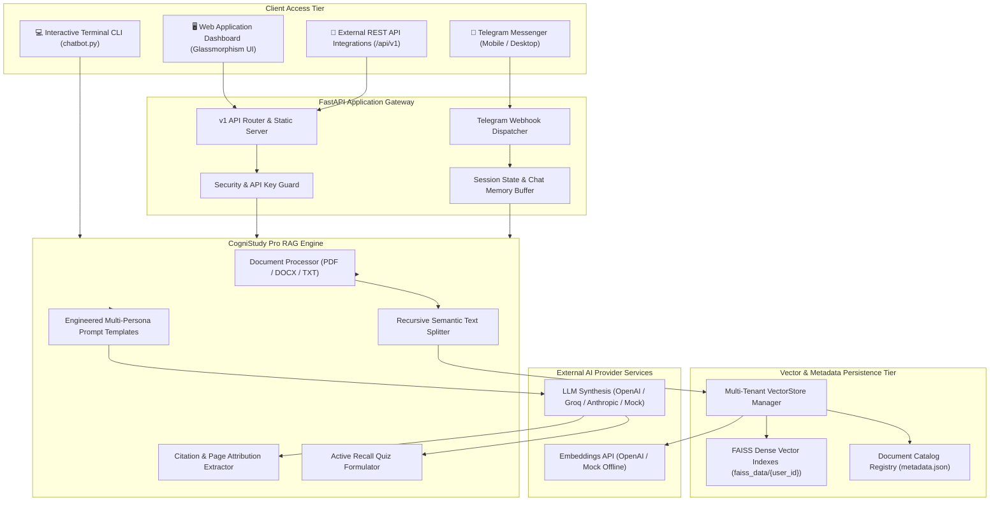

# 🏗️ CogniStudy Pro™ — Technical Architecture Specification

> **Comprehensive system design and technical specification for the CogniStudy Pro™ platform.**

---

## 📐 High-Level Architecture Diagram

---

## 🔄 Detailed Execution Flows

### 1. Document Ingestion Pipeline
1. **Client Upload:** A user uploads a file (`.pdf`, `.docx`, `.txt`, `.md`, `.csv`) via Web UI, REST API, or Telegram.
2. **Sanitization:** `sanitize_filename()` strips directory traversal characters (`../`, special characters).
3. **Format Extraction:**
   * PDF files are parsed page-by-page using PyMuPDF (`pymupdf`) with automatic fallback to `pypdf`.
   * DOCX documents are extracted across all paragraphs and tables using `python-docx`.
   * Text documents are decoded with encoding detection (`utf-8`, `utf-8-sig`, `latin-1`).
4. **Semantic Chunking:** Text is split using `RecursiveCharacterTextSplitter` (1,000 chars, 150 overlap) while preserving page numbers.
5. **Vector Indexing:** Embeddings are generated and persisted into isolated directories (`faiss_data/{user_id}/index.faiss`).
6. **Catalog Update:** Metadata (doc ID, chunk count, timestamp, file size) is logged in `documents_metadata.json`.

### 2. Multi-Persona RAG Query Pipeline
1. **Query Dispatch:** User sends a query with a chosen persona (`student`, `executive`, `researcher`, `exam_cram`).
2. **Context Retrieval:** Similarity search identifies the top-k nearest semantic chunks from the user's vector index.
3. **Prompt Composition:** The system prompt matching the persona is injected with retrieved context and user query.
4. **Synthesis:** The LLM synthesizes an answer strictly grounded in the context.
5. **Citation Attribution:** Exact source filenames, page numbers, and preview snippets are packaged into `Citation` models.

---

## 🛡️ Multi-Tenancy & Isolation
* Each user or team has their own isolated directory: `faiss_data/<user_id>/`.
* Index deserialization is sandboxed and managed per-tenant to prevent cross-account data leakage.
* Clearing an index (`DELETE /api/v1/documents`) removes only that tenant's vector files.
